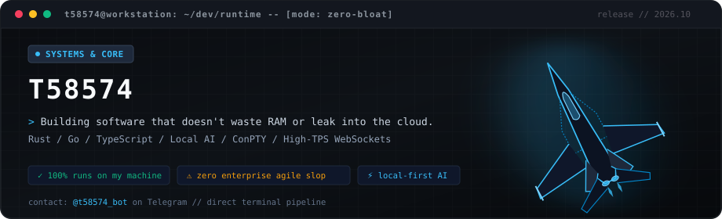

<div align="center">



<br>

<p align="center">
  <a href="https://t.me/t58574_bot"></a>
  
  
  
</p>

</div>

---

### Кто я и что делаю

Пишу софт, который не жрёт память гигабайтами и не лезет в облако без спроса. Специализируюсь на системном бэкенде, локальных нейронках, терминальных инструментах и быстрых интерфейсах.

Никакого корпоративного булшита и бесконечных синков — только работающий код, плоский control flow и максимальный перформанс железа.

---

### Основные проекты (Real Stuff)

- **[Veron](https://github.com/T58574/Veron)** — Нативный терминальный мультиплексор и удаленный dev-сервер. Single-binary на Rust, Axum, Tokio, ConPTY и xterm.js WebGL. Zero-bloat, мгновенный отклик, полная изоляция сессий.
- **[0xVoice2Text](https://github.com/T58574/0xVoice2Text)** — Локальный речевой стек и движок диктовки с задержкой <500ms на Whisper Large V3, Silero VAD и Edge-TTS (PyQt6). Работает оффлайн на чистом GPU.
- **[0xAgent](https://github.com/T58574/0xAgent)** — Автономная платформа для локальных AI-разработчиков и Web-IDE под llama.cpp и гибридные LLM (React 19, TypeScript, C#).
- **[bieb-io](https://github.com/T58574/bieb-io)** — Authoritative 60 TPS сетевой игровой движок на Go с бинарными WebSockets, Canvas-рендером и глубокой системой билдов в стиле PoE.
- **[0xMarkdownView](https://github.com/T58574/0xMarkdownView)** — Расширение для VS Code с Notion-style превью Markdown, поддержкой KaTeX, диаграмм Mermaid и GitHub Alert Callouts.

---

### Стек без воды

```text
Systems & Back:  Rust (Tokio, Axum), Go, C, Python, Node.js
Core Internals:  ConPTY, Linux/Win PTY, High-TPS WebSockets, Async I/O
Local AI Stack:  Whisper (Large V3), Silero VAD, llama.cpp, Local Agents
Frontend & UI:   TypeScript, React, Tailwind CSS, xterm.js (WebGL), PyQt
DevOps & Infra:  Linux VPS, Reverse SSH Tunnels, Docker, Systemd
```

---

### Связь

Есть идея, вопрос или проект? Пиши в бота обратной связи — он пересылает сообщения прямо ко мне в терминал и личку:

- **Telegram:** [@t58574_bot](https://t.me/t58574_bot)
- **GitHub:** [@T58574](https://github.com/T58574)
